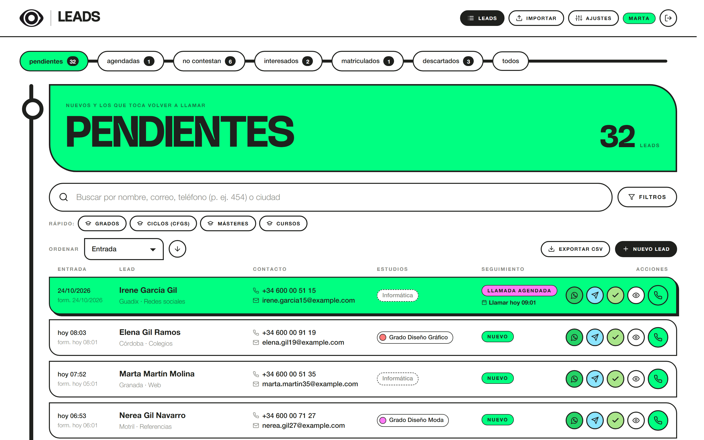
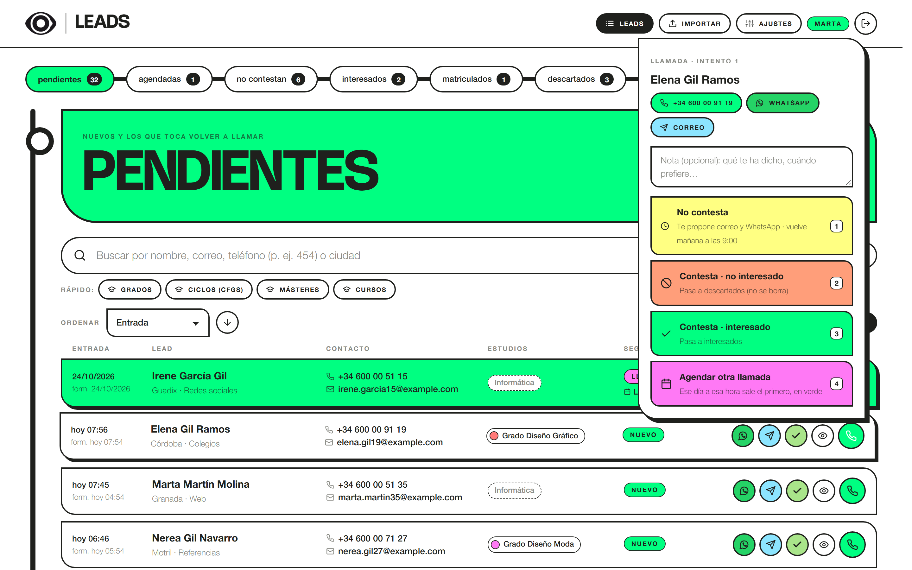
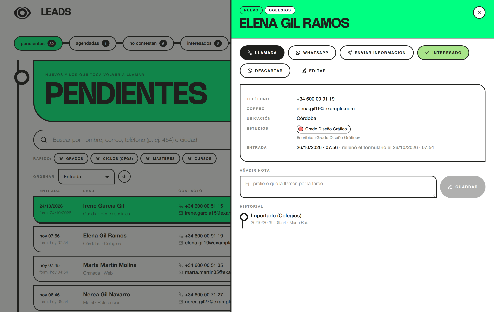
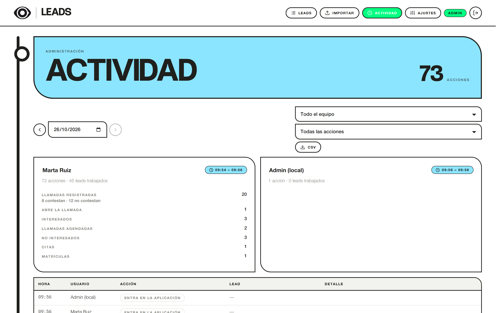
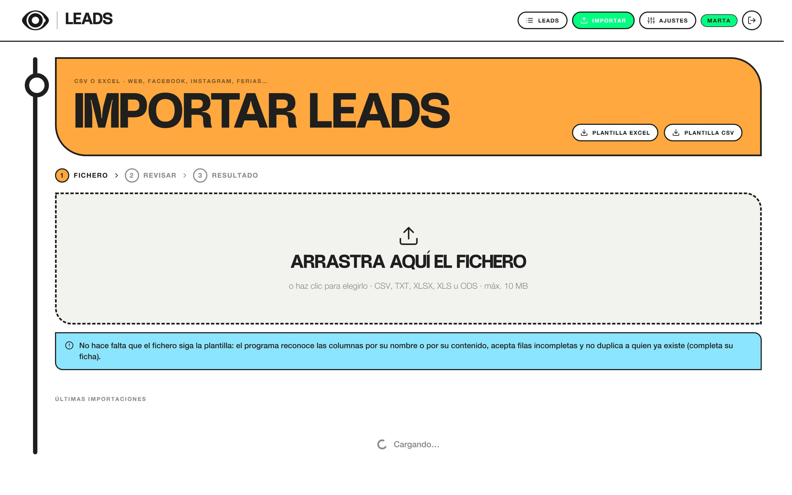

# Leads · Estación Diseño

**La herramienta con la que el equipo comercial de [Estación Diseño](https://estaciondiseno.es/)
(Escuela Superior de Diseño, Granada) llama, sigue y convierte a las personas que piden información.**

Sustituye a un Excel compartido: la aplicación dice a quién toca llamar ahora, en qué orden, y vuelve a
poner en la lista a quien no contestó el siguiente día laborable a las 9:00. El correo con la información y el
dossier de cada estudio sale desde el buzón de cada comercial.



<p align="center">
  
  
</p>
<p align="center">
  
  
</p>

> Las capturas son de la demostración local: nombres, correos `@example.com` y teléfonos inventados.

**PHP 8.1 sin framework · MariaDB · React 19 + Vite · 282 pruebas automáticas · CI en GitHub Actions · desplegado en Plesk**

---

## El problema

Las solicitudes de información llegan por muchos sitios: la web, los formularios de Facebook e Instagram (Meta),
las ferias, los colegios, portales como Emagister o EducaWeb… Antes vivían en hojas de cálculo: cada comercial
tenía que acordarse de a quién había llamado, cuándo volver a intentarlo y qué correo le había enviado. Se
perdían leads, dos personas llamaban al mismo y nadie sabía cuántos intentos llevaba cada uno.

## Lo que hace

- **Una bandeja que piensa por ti.** Pendientes, agendadas, no contestan, interesados, matriculados y
  descartados. El que hay que llamar ahora sale el primero.
- **Llamar en dos teclas.** Cada llamada termina con uno de cuatro resultados (teclas 1 a 4): no contesta,
  no interesado, interesado o agendar otra llamada. Cada resultado mueve al lead al sitio correcto.
- **Seguimiento automático sin tareas programadas.** Si no contesta, se propone el correo y el WhatsApp, y el
  lead vuelve a pendientes el siguiente día laborable a las 9:00 (hora de Madrid, con festivos y cambio de hora).
  Al 6.º intento se descarta solo. Todo se calcula al consultar: no depende de ningún cron.
- **Correo con el dossier de cada estudio**, desde el buzón SMTP de la propia comercial y con copia en su carpeta
  de Enviados por IMAP. Como mucho uno cada 72 segundos en toda la aplicación, para no caer en spam.
- **Importación que no se rompe.** CSV y Excel de cualquier origen: detecta la codificación (incluido el UTF-16
  de Meta), el separador y las columnas por su contenido, empareja los estudios y aprende alias. Los duplicados
  completan el lead existente en lugar de crear otro.
- **Trabajo en equipo.** Un lead queda reservado 5 minutos mientras alguien lo llama, para que no lo llamen dos.
- **Actividad para administración.** Qué ha hecho cada comercial cada día, con resumen y cada acción con su hora.
- **Pensada para usarla todo el día.** Atajos de teclado, buscador sin tildes ni mayúsculas, teléfono por dígitos,
  y funciona en el móvil.

## Arquitectura

```
navegador ── React 19 (SPA, sistema de diseño propio, sin librerías de UI)
   │  fetch /api/* con JWT
   ▼
frontend/dist/.htaccess ── /api → backend.php (la API vive FUERA de la raíz web)
   ▼
backend/public/index.php ── Router → Controller → Service → Repository → MariaDB (PDO)
                                         │
                                       Domain   (reglas de negocio puras, sin base de datos)
```

| Capa | Qué hay | Ejemplos |
|---|---|---|
| `Core` | Router, peticiones/respuestas, configuración, reloj inyectable | `Router`, `Env`, `Clock` / `FrozenClock` |
| `Domain` | Las reglas, sin dependencias: se prueban sin base de datos | `LeadWorkflow` (máquina de estados), `BusinessCalendar` (días laborables, festivos, horario de verano), `ColumnMapper` (adivina columnas), `StudyMatcher` |
| `Application` | Casos de uso que orquestan dominio e infraestructura | `LeadService`, `ImportService`, `MailService`, `AuditService` |
| `Infrastructure` | MariaDB/SQLite, SMTP e IMAP propios, Excel, cifrado | `LeadRepository`, `SmtpTransport`, `ImapClient`, `SecretBox` (AES-256-GCM) |
| `Http` | Controladores finos y la tabla de rutas con permisos | `Routes.php` |

### Decisiones técnicas

- **Sin framework en PHP**, a propósito: el servidor de la escuela es un Plesk compartido (subida por FTP, sin
  terminal), y la aplicación tenía que ser pequeña, entendible y fácil de mantener. El esqueleto (router,
  contenedor, migraciones) son unos pocos archivos.
- **El tiempo es una dependencia.** Todo lo que depende de «ahora» recibe un `Clock`; en las pruebas se congela
  (`FrozenClock`) para comprobar fines de semana, festivos y el cambio de hora.
- **Sin cron.** La vuelta de los que no contestaron se calcula al consultar, así que no hay ninguna tarea
  programada que pueda fallar en silencio.
- **Seguridad:** JWT con caducidad, bloqueo tras 5 intentos fallidos por cuenta e IP, contraseñas de los buzones
  cifradas con AES-256-GCM, protección contra inyección de cabeceras en el correo, la API fuera de la raíz web y
  un instalador que **se niega a arrancar** si el `.env` de producción conserva algún valor de ejemplo.
- **Migraciones versionadas e idempotentes** (`backend/database/migrations`), que se pueden repetir sin peligro.

## Calidad

- **245 pruebas de backend** (PHPUnit) que se ejecutan con SQLite y con MariaDB, y **37 de frontend** (Vitest + jsdom).
- **PHPStan** con reglas estrictas.
- **CI en cada push** (`.github/workflows/ci.yml`): PHP 8.1, 8.3 y 8.4, MariaDB 10.11, ESLint, pruebas y compilación.
- **Pruebas de resistencia:** todas las rutas de la API reciben datos basura (tipos cambiados, textos de 20.000
  caracteres, inyecciones, UTF-8 roto, ids inexistentes) y ninguna puede responder con un 500 ni provocar un aviso
  de PHP. La importación recibe ficheros vacíos, binarios, zips rotos y HTML disfrazado de Excel.

## Documentación

- [Manual del equipo comercial (PDF)](docs/Manual-Leads-Equipo-Comercial.pdf): El manual para quien la usa, con
  casos prácticos y una chuleta para imprimir.
- [DESPLIEGUE.md](DESPLIEGUE.md): instalación y actualizaciones en Plesk.

## Todas las funciones

| Función | Dónde está la lógica |
|---|---|
| Pestañas **Pendientes / Agendadas / No contestan / Interesados / Matriculados / Descartados / Histórico / Todos**, ordenadas por fecha de entrada | `Domain/Lead/Inbox.php`, `LeadRepository::search` |
| Botón de **llamada** con 4 resultados (teclas 1 a 4) y nota opcional; **WhatsApp** y **correo** a mano en el mismo menú | `Domain/Lead/LeadWorkflow.php`, `features/leads/CallMenu.jsx` |
| **WhatsApp** (mensaje prerrellenado) y **correo** disponibles desde el primer momento, fijos en la fila del lead | `LeadActionPolicy.php` |
| **No contesta** → se propone el correo de información y, al aceptarlo, se abre WhatsApp. El lead sale de pendientes y vuelve el siguiente día laborable a las 9:00 (hora de Madrid). Se calcula al consultar: no depende de ninguna tarea programada. Al 6.º intento se descarta solo (configurable) | `BusinessCalendar.php`, `features/leads/FollowUpModals.jsx`, `.env` |
| **Agendar otra llamada** → se elige día y hora; espera en «agendadas» y a esa hora vuelve a pendientes, el primero y en verde | `LeadWorkflow::scheduleCall`, `LeadRepository::PINNED_ORDER` |
| **Tick verde** en la fila para marcar interesado sin llamar (p. ej. si ha contestado por WhatsApp) | `LeadWorkflow::markInterested` |
| Sin teléfono → solo **enviar información por correo** | `LeadActionPolicy.php` |
| **Interesado** → pasa a interesados y se ofrece enviar el correo con la información de sus estudios. Si no sabemos qué quiere estudiar se envía el correo **«Sin estudio»** (Ajustes → Correos) | `Application/MailService.php` |
| **Dossier adjunto**: cada plantilla lleva su PDF (Grado Diseño Gráfico, Grado Diseño Moda, CFGS Ilustración, Máster Oficial de Ilustración y los másteres profesionales de Diseño Gráfico Digital e IA, Moda e Ilustración Avanzada ya vienen con el texto de la comercial y el dossier 26-27). Con varios estudios se envía la genérica con el bloque y el dossier de cada uno | `MailService::compose`, `database/correos/`, Ajustes → Correos |
| **Buzón de cada comercial**: administración le asigna su correo (Ajustes → Usuarios → icono de correo, con los datos de Plesk). Sus correos salen de su dirección y se guarda copia en su carpeta de Enviados por IMAP. Botón «Probar conexión». Sin buzón, sale del general (`MAIL_*`) | `MailAccountService`, `Infrastructure/Mail/PersonalMailbox.php`, `ImapClient.php` |
| **Un correo cada 72 segundos** en toda la aplicación (el servidor admite 50 por hora y así no acabamos en spam). No hay cola: el botón muestra cuánto falta. Configurable con `MAIL_SEGUNDOS_ENTRE_ENVIOS` | `MailService::takeTurn`, `ThrottleRepository` |
| **Actividad** (solo administración): qué ha hecho cada comercial cada día. Resumen por persona (primera y última acción, llamadas y resultados, WhatsApp, correos, notas, interesados, citas…) y cada acción con su hora: entrar, abrir la ficha, abrir la llamada, pulsar el teléfono, resultado, WhatsApp, correo, notas, cambios de estado, importaciones, exportaciones y cambios de ajustes. Exportable a CSV | `AuditService`, `AuditRepository`, `features/activity/ActivityPage.jsx` |
| Antes de enviar, el **correo se puede retocar** (texto y asunto) solo para ese envío, p. ej. «la matrícula cierra el viernes» | `MailService::personalize`, `components/HtmlPreview.jsx` |
| **No interesado** → descartados. Nunca se borra; se puede exportar a CSV y reabrir | `LeadWorkflow::registerCall` |
| Cita agendada y matriculado (embudo completo) | `LeadWorkflow` |
| **Reserva** del lead mientras una comercial lo llama (5 min) para que no llamen dos a la vez | `LeadRepository::lock` |
| **Buscador "contiene"** sin tildes ni mayúsculas: nombre, correo, teléfono por dígitos ("454"), ciudad, varias palabras en cualquier orden. Filtros por estudio, tipo (grados/ciclos/másteres), origen y fechas | `LeadSearch.php`, `LeadRepository::buildWhere` |
| **Importación flexible** CSV/Excel: detecta codificación y separador, cabeceras de web/Facebook/Google Forms y del centro de clientes potenciales de Meta, columnas por contenido, ficheros sin cabecera, filas incompletas, fechas con am/pm; empareja estudios (también por su código dentro del nombre del formulario: «F250454AA \| COMM0023 – Instagram…») y aprende alias; nunca se para por una fila mala | `Domain/Import/*`, `Application/ImportService.php` |
| **Cursos de formación** (Instagram para tu negocio, Gestión de recepción…) además de los estudios de diseño; filtro rápido «Cursos» | migración `2026_09_22_000004_cursos_formacion.php` |
| **Duplicados**: mismo correo o teléfono → se completa el lead existente (y si estaba descartado vuelve a pendientes) | `LeadService::ingest` |
| **Plantilla** descargable en Excel (con desplegables) y CSV | `Infrastructure/Spreadsheet/ImportTemplate.php` |
| Historial por lead (quién, cuándo, qué) y notas | `lead_actividad` |
| Usuarios (admin / comercial), estudios con color, centros y plantillas de correo por estudio | `features/settings/*` |
| **Origen** del lead: se elige uno (Web, Redes sociales, Referencias, Año pasado, Feria, Colegios, AprendeMás, Emagister, TuMaster, EducaWeb). Es obligatorio al dar de alta; los antiguos sin origen salen como «Sin indicar». Al importar se reconoce aunque venga escrito de otra forma («Facebook», «IG», «educaweb.com»…) | `Domain/Lead/LeadOrigin.php` |
| **Empresa: Estación Diseño o Grupo EFP**. Cada estudio es de una de las dos (los de estaciondiseno.es —grados, ciclos, másteres, cursos cortos y subvencionada— de Estación Diseño; el resto de Grupo EFP). El lead es de Estación Diseño si alguno de sus estudios lo es y, si no o sin estudio, de Grupo EFP: se ve al elegir los estudios, en la fila, en la ficha y en el CSV, y se filtra con «Rápido: Estación Diseño / Grupo EFP». La empresa de cada estudio se cambia en Ajustes → Estudios | `Domain/Lead/Company.php`, migración `2026_10_27_000010_empresa_por_estudio.php` |
| **Aviso a la hora de cada llamada agendada**, como un recordatorio de calendario: a quien la agendó le salta un aviso del ordenador (también con la pestaña en segundo plano), una tarjeta con «Llamar ahora» o «En 5 min», un sonido y el título de la pestaña parpadeando; a todas se les actualiza el listado en ese momento para que el lead salga el primero en pendientes, sin recargar. Corrige un reloj del ordenador desajustado y avisa al despertar si el portátil estaba suspendido | `LeadService::reminders`, `components/CallReminders.jsx`, `lib/reminders.js` |
| **«¿Cómo nos has conocido?»** en el primer correo que recibe cada lead, antes de «Quedamos a tu disposición…» | `MailService::withHowFoundQuestion` |
| **WhatsApp tras no contestar** con el texto de la comercial: saludo según la hora, nombre, comercial, escuela, estudio y por dónde llegó («a través de la página TUMASTER») | `LeadPresenter::WHATSAPP_TEMPLATE` |
| **Firma de correo de cada usuario** (Ajustes → Usuarios → icono de nota): se crea con la plantilla de Estación Diseño a partir de nombre, cargo, correo y teléfono, o se pega otro HTML (p. ej. la de Grupo EFP). Va al final de cada correo que envía, también si retoca el texto, y se ve aparte al enviar | `MailService::signature`, `frontend/src/lib/signature.js`, `SignatureModal` |
| **Usuarios por empresa**: en Ajustes → Usuarios, «Leads de» limita a alguien a Estación Diseño (Granada) o a Grupo EFP (Almería, Valladolid…), o le deja las dos. Solo ve, cuenta, exporta y trabaja los leads de esa empresa, solo ve sus estudios y solo da de alta, edita o importa leads que queden en ella (con Estación Diseño hace falta un estudio suyo). Un lead de la otra empresa no existe para él (404) y un duplicado suyo se avisa sin enseñar sus datos | `Company::ofUser`, `LeadService::findOrFail`, `LeadService::scopedQuery` |
| **Histórico**: pestaña con todos los contactos menos los descartados, también los antiguos. En Importar, «Contactos antiguos: importar al histórico» los deja ahí (estado Histórico, con su fecha de alta) sin pasarlos a pendientes; los que ya estaban en la aplicación solo se completan. Un contacto del histórico vuelve a pendientes si se reabre o si vuelve a pedir información | `LeadStatus::HISTORICO`, `Inbox::HISTORICO`, `LeadService::ingest` |
| **Crear estudios que falten** (p. ej. cursos cortos): cualquier usuario, desde el alta del lead, la importación o Ajustes → Estudios. Si ya existe (sin mirar tildes ni mayúsculas, o por un alias) se ofrece ese en lugar de duplicarlo. Se guarda quién lo creó; cambiar o borrar estudios es de administración | `CatalogService::saveStudy`, `StudyModal` |

Preparado para el reparto por centros: tablas `centro` y `estudio_centro` y campo `centro_id` en cada lead.

## Verlo en local

Con **Docker Desktop** abierto, desde la carpeta del proyecto:

```bash
docker compose up --build
```

La primera vez tarda un par de minutos (descarga PHP y MariaDB). Cuando aparezca
`→ Leads en http://localhost:8080`, abre esa dirección.

Se crean solos la base de datos, los 10 estudios con sus colores y **45 leads de ejemplo**
(inventados: nombres falsos, correos `@example.com` y teléfonos que no existen).

| Entrar como | Correo | Contraseña |
|---|---|---|
| Comercial | `marta@estaciondiseno.es` | `DemoLocal2026` |
| Administración | `admin@estaciondiseno.es` | `AdminLocal2026` |
| Administración (atajo local) | `admin` | `admin` |

- **Parar:** `docker compose down` · **parar y vaciar la base de datos:** `docker compose down -v`
- **Si no arranca:** `docker compose logs app --tail 40` dice exactamente qué falla. Lo más habitual:
  `Access denied` (la base de datos se creó antes con otra contraseña → `docker compose down -v` y volver a levantar)
  o que MariaDB no esté levantada (`docker compose ps`). Como salida rápida, se puede arrancar sin MariaDB:
  `set DB_DSN=sqlite:/app/backend/storage/local.sqlite` y luego `docker compose up` (en PowerShell:
  `$env:DB_DSN="sqlite:/app/backend/storage/local.sqlite"`).
- **Empezar sin datos de ejemplo:** `DEMO=0 docker compose up` (en PowerShell: `$env:DEMO=0; docker compose up`)
- Los correos del buzón general no se envían (`MAIL_TRANSPORT=log`): se escriben en `backend/storage/logs/correos.log` y la
  aplicación avisa de que no han salido. **Los de un usuario con buzón propio sí salen de verdad**, también en local.
- Para tocar el diseño con recarga automática: `cd frontend && npm install && npm run dev` → http://localhost:5173
  (envía `/api` al contenedor). Al terminar, `npm run build` regenera `frontend/dist`, que es lo que se sube al servidor.

### Sin Docker

Si tienes PHP 8.1+ instalado, basta con esto (guarda los datos en un fichero SQLite, sin MariaDB):

```bash
# Linux/macOS
DB_DSN="sqlite:$PWD/backend/storage/local.sqlite" JWT_SECRET=bG9jYWwtc29sby1wYXJhLWRlc2Fycm9sbG8tbm8tdXNhci1lbi1wcm9kdWNjaW9u ADMIN_EMAIL=admin@estaciondiseno.es ADMIN_PASSWORD=AdminLocal2026 php backend/bin/demo.php

DB_DSN="sqlite:$PWD/backend/storage/local.sqlite" JWT_SECRET=bG9jYWwtc29sby1wYXJhLWRlc2Fycm9sbG8tbm8tdXNhci1lbi1wcm9kdWNjaW9u php -S localhost:8080 -t frontend/dist backend/bin/dev-router.php
```

En Windows (PowerShell) es lo mismo con `$env:DB_DSN="sqlite:$PWD\backend\storage\local.sqlite"` y las demás
variables antes de cada comando. SQLite solo para verlo en local: en el servidor se usa MariaDB.

## Pruebas y comprobaciones

```bash
# Backend: pruebas (SQLite en memoria) y análisis estático
docker compose exec app sh -c 'cd backend && vendor/bin/phpunit'
docker compose exec app sh -c 'cd backend && vendor/bin/phpstan'

# Backend contra MariaDB real (el mismo motor que el servidor)
docker compose exec -e TEST_DB_DSN="mysql:host=db;dbname=apileads_test;charset=utf8mb4"   -e TEST_DB_USER=apileads -e TEST_DB_PASSWORD=apileads app sh -c 'cd backend && vendor/bin/phpunit'

# Frontend: revisión (ESLint), pruebas de lógica y de componentes (Vitest + jsdom) y compilación
cd frontend && npm run check
```

En GitHub se ejecuta todo en cada push (`.github/workflows/ci.yml`): backend en PHP 8.1, 8.3 y 8.4 con SQLite y
MariaDB, PHPStan y el frontend completo.

Las pruebas cubren los puntos clave: flujo de llamadas y fechas de vuelta (incluido fin de semana,
festivos y cambio de hora), botones disponibles, buscador, importación (Facebook UTF-16, Excel,
Windows-1252, sin cabecera, filas de título, duplicados, errores por fila), correo (plantillas,
dossieres, SMTP, IMAP, límite de envíos, inyección de cabeceras), registro de actividad, sesión,
permisos y límite de intentos de acceso. Además:

- **Resistencia de la API** (`ApiRobustnessTest`): todas las rutas reciben datos mal formados (listas donde va
  un texto, nulos, números enormes, textos de 20.000 caracteres, inyecciones, UTF-8 roto, ids inexistentes) y
  ninguna puede responder con un error 500 ni provocar un aviso de PHP. Cada ruta parte del mismo estado.
- **Ficheros basura al importar** (`ImportRobustnessTest`): vacíos, binarios, zips rotos, HTML con extensión xls…
- **Componentes** (frontend): alta de lead y orígenes, menú de llamada (teclas, doble clic, reserva), envío de
  correo (cuenta atrás, modo pruebas, errores), creación de estudios, red de seguridad y cliente HTTP.

## Estructura

```
backend/
  bin/            migrate.php (instalar/actualizar), demo.php, limpiar-pruebas.php, preparar-plesk.php
  database/       migraciones y plantillas de correo con sus dossieres
  src/            Core · Domain · Application · Infrastructure · Http
  tests/          Unit · Integration (API, importación, correo, resistencia)
frontend/
  src/            app, features (leads, import, activity, settings), components, styles
  test/           lógica y componentes
docs/             manual del equipo comercial y capturas
preparar-plesk.sh paquete listo para subir al servidor (aplicación + base de datos limpia)
```

## Autor

Diseñada y programada por **Pedro Jesús Gómez Pérez** · [pedrogomez.dev](https://pedrogomez.dev) para el equipo
comercial de Estación Diseño, donde está en uso.

El código se publica como muestra de trabajo. La marca, los textos de los correos y los dossieres de los
estudios son de Estación Diseño.
